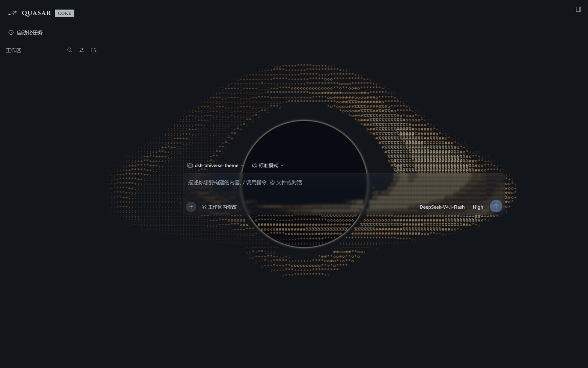
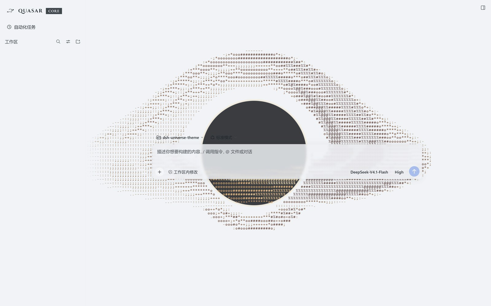

# dsh-quasar-theme

[](#licence)

English | [中文](README.zh.md)

A space-themed skin for **DeepSeek Harness**: an ink black hole in the sidebar
brand row, a live accretion disk behind the app, and one removable override layer
of 53 measured tokens whose translucent surfaces are solved against a contrast
budget rather than picked by eye.

**This repository ships no background picture.** The paint layer is here, the
artwork is not — the tracked wallpaper manifest is empty, so a fresh clone draws
the documented no-art state and makes no third-party request.




Both captures are the current build, dark and light, at 1600×1000. The
conversation list is hidden in both; nothing else is edited.

## Requirements

- DeepSeek Harness with a web profile.
- Node.js >= 18 — only for the build and check tools. The theme itself runs in
  the browser.

## Install

From npm — a versioned tarball with the browser bundle already built in:

```
dsh plugin --profile <profile> add dsh-quasar-theme
```

Straight from the public repository, which tracks its default branch:

```
dsh plugin --profile <profile> add github:WhatCannotBeSaid/dsh-quasar-theme
```

The package carries a `prepare` script that runs exactly that build, so an
install straight from the Git URL produces the bundle before the package is
linked; the npm tarball ships `client.js` ready-made and runs no build. From a
local checkout or a clone of it:

```
npm run build                                   # writes the browser bundle
dsh plugin --profile <profile> add link:<path-to-this-checkout>
```

Run the build once after cloning: `client.js` is generated and deliberately not
tracked (see [Layout](#layout)). A plain `git clone` needs one build — `npm run
build`, or any `npm install` inside the checkout, which triggers `prepare`.

The package declares `dsh.bundle.patch`, so the profile reconciles its bundle
stack against the installed package and mounts the theme. If it does not appear
after a restart, append `dsh-quasar-theme` to `dsh.profile.bundles` in the
profile's `package.json` — a package that is merely a dependency is not mounted.

## Remove

```
dsh plugin --profile <profile> remove dsh-quasar-theme
```

Drop the entry from `dsh.profile.bundles` too if you added it there.

## What it is

| | |
|---|---|
| Modes | Light and dark, one override layer each arm |
| Token layer | 53 measured overrides — 41 in the light arm, 12 in the dark arm |
| Translucent surfaces | Two tokens carry a veil alpha: 0.84 in light, 0.35 in dark. Input cards and menus sit at 0.30 |
| Wallpaper | **None.** The paint layer and its no-art state are here; no artwork ships, is hotlinked, or is fetched at paint time |
| Black hole | A canvas layer behind the app: a photon ring and shadow, a lensed accretion disk whose 24 patches have finite lifetimes and are sheared by their own differential orbit. Phenomenological, not an MHD solve |
| Brand mark | The ink black hole supplied for this theme, drawn at 28×28 inside the sidebar's 36×36 slot |
| Wordmark | `QUASAR` in Cinzel 700 (0.10em tracking) and a `CORE` chip in EB Garamond 500 / 12px, both embedded as data URLs |
| Composer row | The merged model control becomes two independent buttons — model and reasoning effort — each with its own popover, neither with a disclosure chevron |
| Also inside | A pin button on every workspace and session row; a session status rail; the four popovers that hang off the composer row centred on their triggers |
| Language | All user-facing text goes through the official locale service (zh / en) |

The theme installs one layer and can be removed as one. It ships **no settings
panel of its own** — the look is fixed, not a preference — and the only thing it
persists is the workspace pin set, under `uni-theme/workspace-pins`. It does hide
and move a few official entries, so read
[What it changes in the interface](#what-it-changes-in-the-interface) before you
install it.

No boot animation, no non-official-plugin switch, no wallpaper picker: those were
part of the earlier build and are gone.

## What it changes in the interface

Removing the package takes the layer away again and every official element comes
back. In between, the theme **hides six official entries, rewrites the sidebar
identity line, replaces one page's heading, and reshapes the composer's control
row**. All of it is CSS plus a few client effects — the official DOM is never
rewritten.

### The brand row is three click zones

The sidebar brand row reads **[ink black hole] QUASAR CORE**; the official
wordmark and its whale glyph are hidden. It is one official button carrying three
zones, decided from the click's x coordinate at click time:

| Click | Opens | Because |
|---|---|---|
| the ink mark, left of `QUASAR` | the **plugin panel** | the nav's 「插件」 row is hidden, so this is its only door |
| the `QUASAR` text | a **new session** | official behaviour, unchanged |
| the `CORE` chip, right of the text | **Settings** | the 「设置」 launcher button is hidden, so this is the visible door to it |

The mark and the chip both drive hidden official controls programmatically: the
mark clicks the hidden 「插件」 row, the chip clicks the hidden Settings launcher.
When that launcher is absent the chip asks the host's shortcut registry instead.
Only the name's stretch is left alone, so the official new-session handler runs
there. Keyboard activation (Enter or Space on the focused button) and any click
held with a modifier key are left alone. Collapse the sidebar to a rail and there
is no brand button, so there are no zones either.

Both embedded faces are SIL OFL 1.1, latin subset, travelling inside `client.js`
as data URLs, so the row looks the same on a machine that does not have them.
`build/fonts.json` is the provenance record, and the build fails when a file's
byte count disagrees with it (Cinzel 15,184 B, EB Garamond 25,264 B).

### Hidden official entries

| Entry | Where | Way back |
|---|---|---|
| 「应用」/「编辑」 title-bar menu | desktop shell only; absent in a browser | none from inside the app: 关于 / 检查更新 / dsh 命令 / 退出应用 go with it. Quit is still on the tray menu |
| the second 「新会话」 button | sidebar, below the brand row | `QUASAR`, or `Ctrl+N` — it is a duplicate |
| the 「插件」 nav row | sidebar | click the ink mark |
| 「设置」 row and its launcher button | sidebar | click the `CORE` chip, or `Ctrl+,` |
| 「收起侧栏」 button | left sidebar only; the right sidebar's stays visible | the collapse command itself is untouched |
| the session list's bottom fade | sidebar | it only dimmed the last row |
| the account card (only while the DeepSeek account plugin is enabled) | sidebar, in the Settings slot | removed outright, with no gap left where it stood; the chip still opens Settings |

Where a way back names a keyboard shortcut, that is the desktop default — `Ctrl+N`
for a new session, `Ctrl+,` for settings, both of them the official ones,
unchanged by this theme. The web build binds the same two commands to `Ctrl+Alt+N`
and `Ctrl+Alt+,`.

Nothing else in the sidebar moves. The workspace and session list keeps the
official `flex: 1` scrolling area, and the bottom area still shows whatever a
third-party plugin registers into `sidebar.footer.action`, in the position the
host gives it.

### The nav area sits under the title bar (desktop shell only)

The first nav button is level with the 对话 / 轨迹 tab row of the main area instead
of sitting below it, and the Settings row moves underneath the nav instead of
above it. That is the one visible reordering in the sidebar, and it applies to the
desktop shell only — the browser build has no title-bar strip to align to, so its
layout stays the one the host draws.

### The new session page (hero)

That page is the composer and nothing else. Three things are gone, on that page
only: the headline and its fixed German line, the 「预览版」/ “Preview” badge, and
the whale logo above them. The whole row goes, not just its text: an empty flex
row still holds the HeroShell's gap, which reads as a stray blank band rather than
as the composer having moved up. With the row `display: none` the composer sits
where the headline used to be.

### The composer's control row

The row above Send belongs to the host; the theme reshapes it and splits one of
its controls.

- The official merged model control becomes **two buttons**: the model and the
  reasoning effort. Each has its own popover, and opening one closes the other;
  neither carries a disclosure chevron, because the open state is already the
  trigger's own highlight.
- On a narrow row both triggers become 28×28 icon buttons — same box, same ink as
  the add and dictation buttons beside them. A wide row keeps the text labels.
- The whole row shares one seam — 6px when it has room, 3px when it does not — so
  the controls read as one strip instead of drifting groups.
- The four official popovers that hang off that row — permission, session stats,
  token usage and the context meter — are centred on their triggers instead of
  left-aligned with them. The sidebar's own view-options menu is left where the
  host puts it.

### What the theme adds

- A **pin button** on every workspace and session row (置顶工作区 / Pin workspace,
  following the host's language). The pinned set lives in browser storage under
  `uni-theme/workspace-pins`; the order it produces is written through the host's
  own insert-before API, so it survives a restart — and, unlike the pin set, it
  also survives removing the theme.
- The **session status rail**: blue and breathing while a session waits for you
  (an approval, a question, a plan review), red while it is the one open in the
  main area, purple while it finished unread. A pinned row gets a rainbow title
  instead of a rail.
- The **accretion disk** behind the app: a black hole with a lensed disk, drawn on
  a canvas and shaded per cell. Patches are advected by their own orbit, so a patch
  is sheared into an arc instead of sliding as a block. It holds still for anyone
  who asked for reduced motion.
- A **continuous composer transition**: sending the first message of a session
  slides the composer card down as one move instead of fading it out and popping
  a new one in.

Settings themselves remain the official dialog. The single change there is that
the dim tint behind it is removed; the panel and click-outside-to-close are
untouched.

## Layout

```
index.js              host half — mounts, registers no route, plays nothing
client.js             GENERATED browser bundle. Not tracked; build it. Do not edit.
src/client.js         service and effect orchestration
src/theme.css         the token layer
src/tokens.json       the token layer's source of truth for the build
src/runtime/          glass, black hole, geodesic lens, pins, brand routing, panels
src/model-effort-picker.js  the composer's two model/effort controls
cordis.patch.yml      the bundle-patch mount declaration
build/                shipped assets: brand marks, the two OFL fonts, fonts.json
build/wallpapers.json the TRACKED wallpaper manifest — empty in this repository
tools/                build, self-check, token audit, tests
docs/                 design log, recon, audits, render reports
NOTICE                upstream licences and third-party credits
LICENSE               this package's layered licence
LICENSE-CC-BY-NC-SA-4.0.txt  the CC licence text for the brand marks
```

`client.js` is generated from `src/` and carries a banner saying so. Edit `src/`
and run `npm run build`; the check gate fails if the two drift apart.

`build/wallpapers.json` is tracked and currently empty. An empty manifest is the
documented no-art state: the build publishes `--cp-pick-light: none; --cp-pick-dark:
none;` and the paint layer draws nothing. A `direct:` entry would make the build
emit `url("https://…")` and the browser fetch that host at paint time — nothing in
this repository does that today. `out/wallpapers.local.json` (git-ignored) can
carry `dataUrl:` entries for a local build; `--mode public` ignores it.

## Checks

```
npm run verify
```

Runs the development gates: syntax checks on both bundle halves, the behavioral and
build-contract tests in `tools/*.test.mjs`, the static self-check (113 assertions,
all green at this version), the 53-token audit, and an exact artifact/source
comparison. Build and check commands accept the same `--mode auto|public|local`.

Individual gates: `npm run build` (writes `client.js`), `npm run check` (compares
it against `src/` without writing), `npm run selfcheck`, `npm run audit`, `npm test`.

Release validation is `npm run verify:release -- --mode public --host-version
<exact-version>`. Fresh target-host evidence, collection time and input hashes are
required; old dumps without provenance yield a partial development audit, not
verified compatibility. `npm run measure:resources` measures local compression and
Node compilation, not browser performance. Publish from a clean isolated checkout
without `out/`, then validate the packed artifact's public mode.

See [S1–S10 implementation and acceptance record](docs/optimization-s1-s10.md)
for limitations and rollback.

## Licence

This package uses **tiered licensing**. Each licence applies only to the part it is
named against; none of them is an alternative licence for the whole repository.
Catalogue data (`build/*.json`) describes assets without licensing them. No
trademark rights are granted here.

| Part | Licence | What it asks of you |
|---|---|---|
| Our code — `index.js`, `src/`, `tools/`, `client.js` | MIT | Keep the copyright and licence notice. Commercial use of the code is fine. |
| Project text — this README, `docs/`, `NOTICE`, `LICENSE` | CC BY-NC-SA 4.0 | Credit, link the licence, note changes, keep it non-commercial, share alike. |
| Fonts — `build/cinzel-latin-700.woff2`, `build/eb-garamond-latin-500.woff2` | SIL OFL 1.1 | Keep the licence with the font; the texts ship beside them as `build/cinzel-OFL.txt` and `build/eb-garamond-OFL.txt`. |
| The earlier brand marks still in the tree — `build/whale-maid-small-monochrome-diagonal.svg`, `build/brand-mark*.png`, `build/brand-mark.jpg` | CC BY-NC-SA 4.0 | Same terms as the project text, and this is third-party artwork: see below. |

Because those third-party marks carry a non-commercial term and still ship in the
package, **the package as a whole may not be used commercially**. The MIT code on
its own is not restricted; drop the marks if you need a commercial-use build.

Full terms: [LICENSE](LICENSE). Upstream texts and per-file credits:
[NOTICE](NOTICE). The CC BY-NC-SA 4.0 legal text ships as
[LICENSE-CC-BY-NC-SA-4.0.txt](LICENSE-CC-BY-NC-SA-4.0.txt) and is also at
<https://creativecommons.org/licenses/by-nc-sa/4.0/>.

## Third-party marks and credits

**Current brand mark.** `build/brand-mark-black-hole.png`, the ink black hole the
sidebar draws, was supplied for this theme. It is not character artwork and names
no third party.

**Earlier brand mark.** Character 溟月 by 上善无形 (original character,
<https://space.bilibili.com/4456176>). DeepSeek-elements second pass by ZipZipPipe
(GPT Image 2, <https://space.bilibili.com/4168597>). Refined repair by QYQCAMIAO.
Licensed CC BY-NC-SA 4.0 — credit, non-commercial, share alike. The illustration
ships as the supplied SVG, `build/whale-maid-small-monochrome-diagonal.svg`, drawn
unmodified. The earlier cropped 256×256 PNGs stay in the tree for rollback only,
under the same terms. This theme no longer draws any of them; commercial use of
this artwork would need permission from the rights holders above.

**Fonts.** Cinzel, Copyright 2020 The Cinzel Project Authors; EB Garamond,
Copyright 2017 The EB Garamond Project Authors. Both SIL OFL 1.1, latin subset,
from `@fontsource`, embedded in `client.js` as data URLs.

**No other artwork.** No wallpaper, no character illustration and no third-party
image is distributed with this package, and nothing is fetched from a third-party
host at paint time.

**History.** Earlier versions of this package were an EVA-inspired theme with two
hotlinked wallpapers, a boot mask and a non-official-plugin switch. Those were
removed on 2026-10-27 and 2026-10-31 — the last of the wallpapers first, the boot
mask and the switch with the rename to `dsh-quasar-theme`. Nothing in the
current build depends on khara, inc., its characters, or any other rights holder
named in earlier copies of this file.
