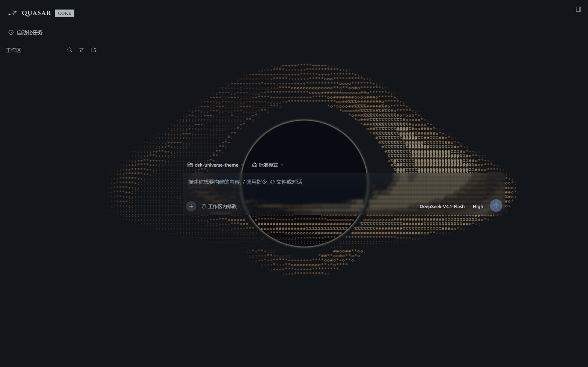
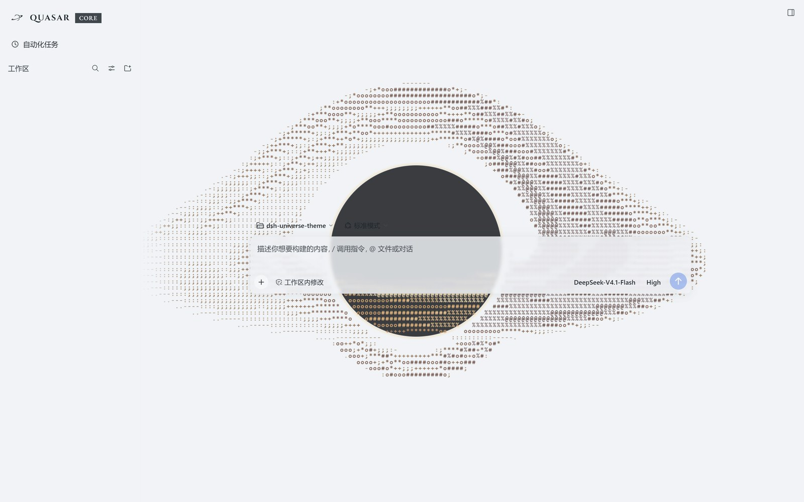

# QUASAR —— dsh-quasar-theme

[](#许可)

[English](README.md) | 中文

**QUASAR（类星体）** 是给 **DeepSeek Harness** 的太空主题皮肤：侧栏品牌位是一颗墨色黑洞，应用背后是一张活的吸积盘，界面样式全部压在一层可整层移除的覆盖层里——53 个实测令牌，半透明面的 alpha 是按对比度预算解出来的，不是凭眼睛配的。

这个名字是界面本来就有的那个——侧栏写着 `QUASAR CORE`——包名跟它一致：`dsh-quasar-theme`。类星体就是带吸积盘与喷流的黑洞，正是那层 canvas 画的东西。

**本仓库不提供任何背景画作。** 涂装层在这里，画作不在——被跟踪的壁纸清单是空的，所以全新克隆画的是「无画作」这一明示状态，并且在绘制时不向任何第三方主机发起请求。




两张都是当前版本的实拍，深色与浅色各一，1600×1000。两张都隐藏了会话列表，其余未作改动。

## 运行要求

- 带 web profile 的 DeepSeek Harness。
- Node.js >= 18 —— 只用于构建与检查工具。主题本身在浏览器里运行。

## 安装

从 npm 安装 —— 版本化 tarball，浏览器包已构建好一并发出：

```
dsh plugin --profile <profile> add dsh-quasar-theme
```

直接从公开仓库安装（跟踪默认分支）：

```
dsh plugin --profile <profile> add github:WhatCannotBeSaid/dsh-quasar-theme
```

包里带一个 `prepare` 脚本，跑的就是那次构建，所以从 Git URL 安装会在包被链接之前把浏览器包产出来；npm tarball 直接带成品 `client.js`，不执行构建。从本地检出安装：

```
npm run build                                   # 写出浏览器包
dsh plugin --profile <profile> add link:<本检出的路径>
```

克隆后先构建一次：`client.js` 是生成物，且刻意不进版本库（见[目录结构](#目录结构)）。普通 `git clone` 需要一次构建——`npm run build`，或在检出任一目录内跑 `npm install`（会触发 `prepare`）。

包声明了 `dsh.bundle.patch`，profile 会据此把 bundle 栈与已安装包对账并挂载主题。若重启后没出现，把 `dsh-quasar-theme` 追加到 profile 的 `package.json` 里 `dsh.profile.bundles` —— 只是依赖、没有进 bundles 的包不会被挂载。

## 卸载

```
dsh plugin --profile <profile> remove dsh-quasar-theme
```

如果你手动往 `dsh.profile.bundles` 里加过条目，一并删掉。

## 这是什么

| | |
|---|---|
| 模式 | 亮 / 暗两档，每个分支一层覆盖 |
| 令牌层 | 53 个实测覆盖 —— 亮档 41 个、暗档 12 个 |
| 半透明面 | 两个令牌承载纱层 alpha：亮 0.84、暗 0.35；输入卡与菜单固定在 0.30 |
| 壁纸 | **无**。涂装层与它的「无画作」状态在这里；不附任何画作、不热链、绘制时不抓取 |
| 黑洞 | 应用背后的 canvas 层：光子环与阴影，加上被引力透镜弯折的吸积盘。24 个斑块有有限寿命，并按各自的差速轨道被剪切。现象学模型，不是 MHD 解 |
| 品牌标 | 为本主题提供的墨色黑洞，按 28×28 画在侧栏 36×36 的槽位里 |
| 字标 | `QUASAR` 用 Cinzel 700（字距 0.10em），加一枚 `CORE` 芯片用 EB Garamond 500 / 12px，两者都以 data URL 内嵌 |
| 组合器行 | 保持宿主的官方控件——合并的模型按钮与它的面板都不动 |
| 另外加入 | 每个工作区/会话行上的置顶按钮；会话状态轨；组合器行下挂的四个 popover 居中对齐到触发按钮 |
| 语言 | 所有面向用户的文字都走官方 locale 服务（zh / en） |

主题只装一层，可以整层移除。它**没有自己的设置面板**——外观是定死的，不是偏好项——唯一持久化的东西是置顶集合，键名 `quasar-theme/workspace-pins`。它会隐藏并搬动少量官方入口，装之前请先看[它改动了界面的哪些地方](#它改动了界面的哪些地方)。

## 它改动了界面的哪些地方

卸掉包，这一层就没了，官方元素全部回来。装着的期间，主题**隐藏 7 个官方入口、改写侧栏的身份行、去掉新会话页的标题行、把组合器行下挂的四个 popover 居中**。全部是 CSS 加少量前端效果——官方 DOM 从不被重写。

### 品牌位是三段点击区

侧栏品牌位读作 **[墨色黑洞] QUASAR CORE**；官方字标与它的鲸鱼字形被隐藏。它仍是一个官方按钮，三个区由点击时的 x 坐标决定：

| 点击 | 打开 | 为什么 |
|---|---|---|
| 墨标，`QUASAR` 左侧 | **插件面板** | 导航里的「插件」行被隐藏，这是它唯一的门 |
| `QUASAR` 文字 | **新会话** | 官方行为，未改 |
| `CORE` 芯片，文字右侧 | **设置** | 「设置」启动按钮被隐藏，这是它可见的门 |

墨标与芯片都是程序化驱动被隐藏的官方控件：墨标点击隐藏的「插件」行，芯片点击隐藏的设置启动按钮。该启动按钮不存在时，芯片改为请求宿主快捷键注册表。只有文字那一段不接管，官方的新建会话处理器仍在上面运行。键盘激活（聚焦按钮上的 Enter / Space）与任何带修饰键的点击都不接管。收起侧栏成窄轨后没有品牌按钮，也就没有三段。

两个内嵌字体都是 SIL OFL 1.1、latin 子集，以 data URL 随 `client.js` 一起走，所以机器上没装这两款字体也一样显示。`build/fonts.json` 是出处记录，构建时文件字节数对不上就失败（Cinzel 15,184 B，EB Garamond 25,264 B）。

### 被隐藏的官方入口

| 入口 | 位置 | 怎么回去 |
|---|---|---|
| 「应用」/「编辑」标题栏菜单 | 仅桌面外壳；浏览器里不存在 | 应用内没有回路：关于 / 检查更新 / dsh 命令 / 退出应用一并消失。退出仍在托盘菜单 |
| 第二个「新会话」按钮 | 侧栏，品牌位下方 | `QUASAR`，或 `Ctrl+N` —— 它只是重复入口 |
| 「插件」导航行 | 侧栏 | 点墨标 |
| 「设置」行与它的启动按钮 | 侧栏 | 点 `CORE` 芯片，或 `Ctrl+,` |
| 「收起侧栏」按钮 | 仅左侧栏；右侧栏的保留 | 折叠命令本身未动 |
| 会话列表底部的渐隐 | 侧栏 | 它只压暗最后一行 |
| 账户卡（仅在启用 DeepSeek account 插件时存在） | 侧栏，在设置槽位 | 整块移除，不留原来占位的空隙；芯片照样打开设置 |

凡「怎么回去」里写了快捷键的，都是桌面默认值——`Ctrl+N` 新建会话、`Ctrl+,` 打开设置，两者都是官方快捷键，本主题未改。web 版把同样的两条命令绑在 `Ctrl+Alt+N` 与 `Ctrl+Alt+,`。

侧栏其他东西不移动。工作区与会话列表仍是官方的 `flex: 1` 滚动区；底部仍显示第三方插件注册到 `sidebar.footer.action` 的内容，位置由宿主给。

### 导航区上移到标题栏下方（仅桌面外壳）

第一个导航按钮与主区「对话 / 轨迹」标签行齐平，而不是在它下方；设置行移到导航下方，而不是上方。这是侧栏里唯一可见的重排，且只作用于桌面外壳——浏览器版没有标题栏条可对齐，布局保持宿主画的样子。

### 新会话页（hero）

那一页上，官方在组合器上方画一行标题：鲸鱼墨标、标题「探索未至之境」/ "Into the Unknown"、以及「预览版」/ "Preview" 徽章——即官方语言字典里的 `hero.headline` 与 `hero.preview`。主题把这一整行藏掉，于是那一页只剩组合器。藏的是整行而不只是文字：空的 flex 行仍占着 HeroShell 的间距，看起来像一条多余空白带，而不是组合器上移了。行 `display: none` 之后，组合器就落在标题原来的位置。该位置不补任何东西——主题不往那儿写任何文案。

### 组合器的控件行

发送键上方那一行属于宿主，里面的每个控件都保持宿主原样——包括合并的模型按钮与它的面板；主题自 2026-11-14 起不再替换那个控件。

- 行下挂的四个官方 popover——权限、会话统计、token 用量、上下文计量——改为居中于各自的触发按钮，而不是与它们左对齐。侧栏自己的视图选项菜单保持宿主给的位置。

### 主题加入的东西

- 每个工作区与会话行上的**置顶按钮**（置顶工作区 / Pin workspace，跟随宿主语言）。置顶集合存在浏览器存储 `quasar-theme/workspace-pins`；由它产生的顺序通过宿主自己的 insert-before API 写入，所以重启后仍在——而且与置顶集合不同，卸载主题后顺序也仍然保留。
- **会话状态轨**：会话在等你时（审批、提问、计划复核）蓝色呼吸，是主区当前打开的那一个时红色，刚结束未读时紫色。被置顶的行改用彩虹标题替代状态轨。
- 应用背后的**吸积盘**：一颗带透镜盘的黑洞，画在 canvas 上、逐格着色。斑块按自身轨道被平流，所以斑块会被剪切成弧，而不是整块平移。请求了减少动效的人看到的是静止画面。
- **连续的组合器过渡**：发出会话的第一条消息时，组合器卡片整体下滑，而不是淡出再弹一个新的进来。

设置本身仍是官方对话框。那里唯一的改动是去掉其背后的暗色遮罩；面板本身与点击外部关闭都未动。

## 目录结构

```
index.js              宿主侧一半 —— 只挂载，不注册路由、不播放任何东西
client.js             生成的浏览器包。不进版本库，需要构建。不要手改。
src/client.js         服务与效果的编排
src/theme.css         令牌层
src/tokens.json       构建时令牌层的唯一事实来源
src/runtime/          玻璃、黑洞、测地透镜、置顶、品牌路由、面板
cordis.patch.yml      bundle-patch 挂载声明
build/                随包资源：品牌标、两款 OFL 字体、fonts.json
build/wallpapers.json 被跟踪的壁纸清单 —— 本仓库里为空
tools/                构建、自检、令牌审计、测试
docs/                 设计日志、勘察、审计、渲染报告
NOTICE                上游许可与第三方署名
LICENSE               MIT，另加字体的例外条款
```

`client.js` 由 `src/` 生成，文件头有说明。改 `src/` 后跑 `npm run build`；两者漂移会被检查闸门拦下。

`build/wallpapers.json` 被跟踪，当前为空。空清单就是明示的「无画作」状态：构建发出 `--cp-pick-light: none; --cp-pick-dark: none;`，涂装层什么都不画。`direct:` 条目会让构建发出 `url("https://…")`，浏览器在绘制时去抓那个主机——本仓库目前没有任何条目这么做。`out/wallpapers.local.json`（git 忽略）可在本地构建时放 `dataUrl:` 条目；`--mode public` 会忽略它。

## 检查

```
npm run verify
```

跑开发闸门：两半包的语法检查、`tools/*.test.mjs` 里的行为与构建契约测试、静态自检（本版本 113 条断言全绿）、53 个令牌的审计、以及产物与源码的精确比对。构建与检查命令都接受同样的 `--mode auto|public|local`。

单项闸门：`npm run build`（写 `client.js`）、`npm run check`（只比对不写）、`npm run selfcheck`、`npm run audit`、`npm test`。

发布校验是 `npm run verify:release -- --mode public --host-version <精确版本>`。需要当次目标宿主的新鲜证据、采集时间与输入哈希；没有出处的旧 dump 只能给出部分开发审计，不算已验证兼容。`npm run measure:resources` 测的是本地压缩与 Node 编译，不是浏览器性能。发布请从干净、隔离、无 `out/` 的检出进行，然后校验打包产物的 public 模式。

限制与回滚见 [S1–S10 实施与验收记录](docs/optimization-s1-s10.md)。

## 许可

本包是 **MIT**，只有两款字体文件例外。包里没有任何非商业条款，也不含第三方画作——唯一的图片是为本主题绘制的品牌标。

| 部分 | 许可 | 对你的要求 |
|---|---|---|
| 其余全部 —— `index.js`、`src/`、`tools/`、`client.js`、`docs/`、两份 README、`build/*.json`、品牌标 | MIT | 保留版权与许可声明。可商用。 |
| 字体 —— `build/cinzel-latin-700.woff2`、`build/eb-garamond-latin-500.woff2` | SIL OFL 1.1 | 字体随许可一起走，不得单独售卖字体；许可全文就在旁边：`build/cinzel-OFL.txt`、`build/eb-garamond-OFL.txt`。 |

完整条款：[LICENSE](LICENSE)。逐文件署名：[NOTICE](NOTICE)。

## 第三方标记与署名

**品牌标。** `build/brand-mark-black-hole.png`——侧栏画的那颗墨色黑洞——是专为本主题提供的，与代码同用 MIT 授权。它不是角色画作，不是由他人图片改来，不指向任何第三方。本包不含其他图片。

**字体。** Cinzel，Copyright 2020 The Cinzel Project Authors；EB Garamond，Copyright 2017 The EB Garamond Project Authors。均为 SIL OFL 1.1、latin 子集，取自 `@fontsource`，以 data URL 内嵌在 `client.js`。

**没有其他画作。** 本包不发行任何壁纸、角色插画或第三方图片，绘制时不向任何第三方主机抓取内容。
